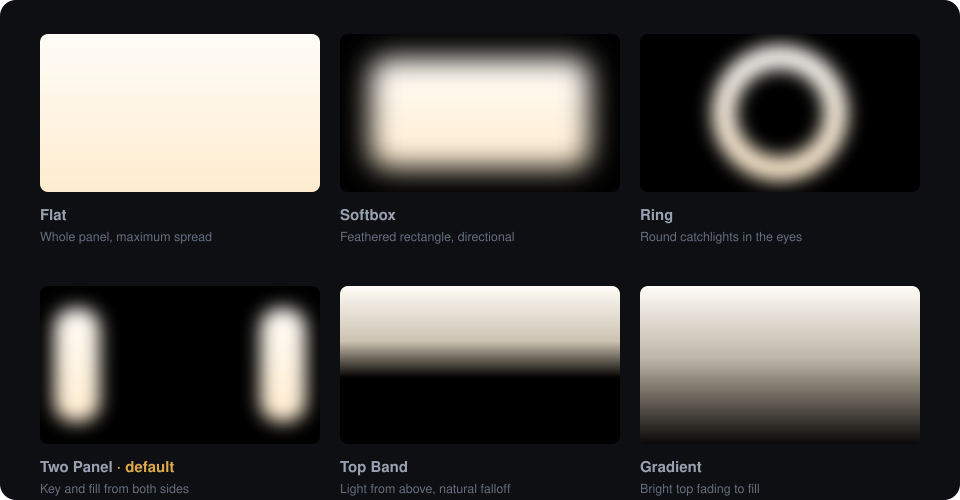
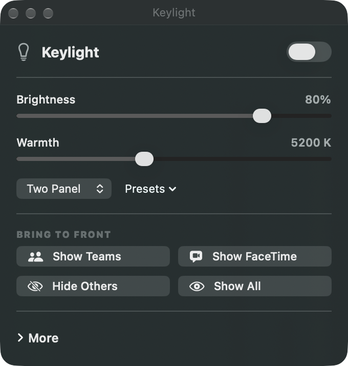

<div align="center">

# Keylight

**Turn the screen you already own into a proper key light for video calls.**

Two native apps in one repo — one for Apple TV, one for the Mac.
Real colour science, shapes that actually flatter a face, and controls you can reach mid-call.


</div>

---

Webcams are starved of light. The fix is usually a £100 panel on a desk arm — but there is
already a large, colour-accurate, fully dimmable light source pointed straight at your face.
Keylight makes the TV in front of you, or the Mac you're working on, behave like a real
fixture: colour temperature on the Planckian locus, a ±green trim, and a shape you can aim.

<div align="center">
  
</div>

Shape is not decoration. On an OLED the auto-brightness limiter cuts peak output as the lit
area grows, so a **Softbox** over ~65% of a 55" panel measures *brighter at your face* than a
full-field white raster — and puts less total charge through the panel. On a Mac, **Two Panel**
lights the far edges of the display, which is exactly where your call window isn't.

---

## 📺 Keylight for Apple TV

Built for a 55" panel facing you, driven entirely from the Siri Remote.

| Input | Does |
|---|---|
| **Up / Down** | Brightness. Always, everywhere. |
| **Left / Right** | The assigned dial — Temperature by default. Reassign in the panel. |
| **Click centre** | Open / close the control panel |
| **Play / Pause** | Blackout — kills the light instantly, press again to restore |
| **Menu** | Closes what's open; from the bare light it leaves the app |

Hold a direction to accelerate: one tap moves 25 K, a hold sweeps 2000–10000 K in about two
seconds. The readout fades after 2.5 s so the panel goes back to being nothing but light.

Also: ten presets plus unlimited saved slots, a **camera test card** (18% grey, step wedge and
skin-tone swatches rendered at your current colour temperature), auto-off with a 60-second
warning, an OLED burn-in guard that drifts the image every 75 s, and the screensaver disabled
while the app is in front.

→ **[Full setup and deployment guide](SETUP.md)**

## 💻 Keylight for Mac

A menu-bar agent — no Dock icon, a lightbulb in the menu bar, and a small control box in the
corner.

<div align="center">
  
</div>

The setting that makes it useful is **stacking**:

- **Behind apps** — the light sits above the wallpaper and desktop icons but below every app
  window. Nothing ever covers your work; the trade is that windows cover the light.
- **In front** — the light floats above everything, but `ignoresMouseEvents` is set, so clicks,
  scrolls and drags pass straight through. You cannot tell it's there except for the light.

In-front mode only works because the shaped layouts leave the middle of the screen fully
transparent rather than black.

Plus: a display picker that follows monitors being plugged and unplugged, hard-to-soft edges,
an **edge to edge** mode (the Ring becomes a frame around the screen border), separate ring
size and width, **Show Teams /
Zoom / Slack / FaceTime** buttons for whatever is actually installed, **Hide Others** to clear
the screen in one click, optional **follow-the-camera** (light comes up when another app opens
the camera, drops when it lets go — Keylight never opens it itself), display-sleep held off
while lit, and open-at-login.

→ **[Mac app details](KeylightMac/README.md)**

---

## The colour science

Temperatures run through the Planckian locus (Kim et al. cubic fit) → CIE 1931 xy → XYZ →
linear sRGB, normalised on the peak channel the way a real RGBW fixture drives its emitters.
Brightness scales the *encoded* signal so the dimmer feels evenly spaced to the eye.

Verified numerically against known reference points:

| Kelvin | CIE x | CIE y | sRGB 8-bit | |
|---|---|---|---|---|
| 2000 K | 0.527 | 0.413 | `255 139 22` | candle |
| 2700 K | 0.459 | 0.411 | `255 173 89` | tungsten bulb |
| 4000 K | 0.381 | 0.377 | `255 211 165` | soft white |
| 5600 K | 0.330 | 0.339 | `255 239 228` | daylight |
| **6500 K** | 0.313 | 0.324 | `255 249 254` | **≈ D65 white** |
| 10000 K | 0.281 | 0.288 | `205 217 255` | overcast |

6500 K lands on D65 — as it must, since that is the sRGB white point — and the warm-to-cool
ramp is strictly monotonic across the whole range.

## Build it

Both are plain Xcode projects with no dependencies, no package manager, nothing to install.

```bash
git clone https://github.com/cjcombsMedia/appletv-keylight-white-screen.git
cd appletv-keylight-white-screen
```

**Apple TV** — open `Keylight.xcodeproj`, set your own Team under Signing & Capabilities, pair
your Apple TV over the network (Xcode → Window → Devices and Simulators), then ⌘R.
[SETUP.md](SETUP.md) covers pairing, free-vs-paid provisioning, and the TV picture settings
that actually matter.

**Mac** — open `KeylightMac/KeylightMac.xcodeproj` and ⌘R, or build and copy to /Applications:

```bash
xcodebuild -project KeylightMac/KeylightMac.xcodeproj -scheme KeylightMac -configuration Release build
```

> **Signing:** both projects carry a `DEVELOPMENT_TEAM` that is not yours. Change it to your own
> team (or set *Sign to Run Locally*) before building. The Mac target is ad-hoc signed and
> unsandboxed, so it can focus and hide other apps.

## Repo layout

```
Keylight.xcodeproj          tvOS app
Keylight/
  Model/      ColorScience · LightState · LightStore
  Input/      MoveAccelerator — hold-to-accelerate for the remote
  Views/      the six shapes, HUD, control panel, test card
KeylightMac/                macOS app (own project)
  KeylightMac/
    Light/    LightStageView · LightWindowManager (one window per display)
    Controls/ panel, app switching, hide-others, camera monitor, login item
Tools/generate_icons.py     generates the layered tvOS parallax icon
docs/                       standards, build story, value receipt
```

`ColorScience.swift` is duplicated between the two targets rather than shared, so a change to
the colour maths needs applying in both places. That is a deliberate trade to keep the shipped
tvOS project untouched while the Mac app was added.

## Notes

- **tvOS app icons need the tvOS Simulator runtime installed** (`xcodebuild -downloadPlatform tvOS`),
  even for a device-only build. Without it `actool` fails with a misleading
  *"No available simulator runtimes"* error. Details in [SETUP.md](SETUP.md).
- Deployment targets are tvOS 17 and macOS 14, both still supported by current Xcode.
- MIT licensed — see [LICENSE](LICENSE).
